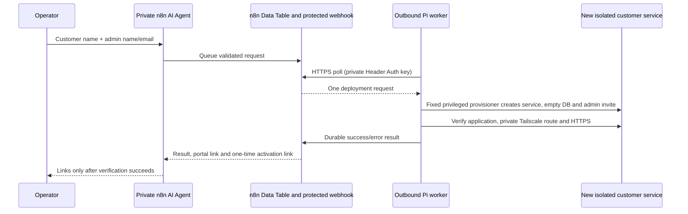

# n8n Cloud → private Raspberry Pi customer deployment

The customer request needs only:

```json
{
  "customerName": "Your customer name",
  "adminName": "First administrator full name",
  "adminEmail": "admin@customer.example"
}
```

The workflow generates a durable requestId. No administrator password is collected or transmitted. A one-time invitation lets the administrator choose their own password after deployment. **New customer workspaces have zero projects, workstreams, tasks or RAID records.** No example database is copied.

## How it connects



There is **no inbound connection from n8n Cloud to the Pi**. The Pi polls n8n over outbound HTTPS every five minutes while idle and immediately checks for another queued request after finishing a deployment. It uses Tailscale Serve for customer access, not Funnel. The worker has no HTTP listener, and no SSH password/key is needed by n8n Cloud. Configure this trusted deployment agent for your own authenticated operators, not as a public customer chatbot.

## 1. One-time install on your existing Pi

Your original `pathtoo` service, port 3000, and HTTPS port 443 remain separate. This does not upgrade or restart those customer services. From your existing source checkout:

```sh
cd ~/pathtoo-pmo
git status --short
git pull --ff-only origin pathtoo-pmo
sudo bash deploy/install-provisioner.sh
```

Preserve local changes before pulling. The installer needs 64-bit Raspberry Pi OS, systemd, Tailscale, sudo, and the Node runtime already installed by `deploy/install-node-pi.sh`. It runs the automated tests, copies an explicit code-only release into root-owned `/opt/pathtoo-provisioner/releases`, and creates:

| Item | Purpose |
| --- | --- |
| `/usr/local/sbin/pathtoo-provision` | Fixed root command; bounded JSON stdin only; no arguments or shell input |
| `/etc/sudoers.d/pathtoo-provision` | Permits only that no-argument command for `pathtoo-automation` |
| `/etc/pathtoo-provisioner.json` | Root-owned capacity and port settings |
| `/var/lib/pathtoo-provision/requests` | Root-only request manifests, reservations and install logs |
| `/etc/pathtoo-worker.env` | Root-only n8n URL/key/worker identity settings |
| `/var/lib/pathtoo-worker` | Private callback spool for temporary n8n outages |
| `pathtoo-worker.service` | Outbound poller running as an unprivileged service account |

Defaults reserve at most 10 automated customers, with app ports starting at 3300 and HTTPS ports starting at 8443 (30 candidate ports each). Existing occupied ports and Tailscale routes are skipped. The limit is a guard, not a tested Pi capacity guarantee. Review memory/storage and adjust limits down for your Pi; changing them requires editing the root-owned config. Do not set overlapping app and HTTPS port ranges. The installer keeps older trusted code releases for operator rollback; it never pulls remote code at job execution time.

Ensure Tailscale is already signed in and tailnet HTTPS certificates are enabled. Inspect:

```sh
tailscale status
sudo tailscale serve status
```

Your existing working Tailscale HTTPS portal should have completed that account-level certificate step. Tailnet grants must allow the intended users to reach the newly allocated HTTPS ports; provisioning does not change your Tailscale ACLs, add tailnet users, or join users to the network.

## 2. Set up n8n Cloud once

Download/import these workflow JSON files from the repository's `n8n/` folder into the **same n8n project**:

1. `setup-queue-table.json`: run manually once. It creates or reuses `pathtoo_deployments` with five string columns: `requestId`, `workerId`, `payload`, `status`, `result`. If the table already exists, verify all five columns; reuse does not migrate a different schema. Do not delete existing deployment rows to retry a job.
2. `worker-queue.json`: the protected production webhook and durable claim/completion flow.
3. `deploy-customer-tool.json`: the agent's deploy/wait/resume tool.

These templates use n8n Data Table node version 1.1 and standard Code/If/Wait/Webhook nodes. They were generated against n8n's public node definitions. They are not yet validated in your live n8n tenant; if Data Table version 1.1 is unavailable, update n8n or recreate the equivalent Data Table nodes using your supported version. Name-based table selection is preconfigured; otherwise select the same table explicitly in every Data Table node.

In the **Worker webhook** node create/select an **HTTP Header Auth** credential:

- Header name: `X-Pathtoo-Worker-Key`
- Header value: a private random value of at least 32 characters (recommended: 64 hex characters).

Generate that value locally if needed with `openssl rand -hex 32`. Enter it only in n8n's credential UI and the Pi's root-only worker settings. Do not commit it or send it in chat. No credential values are included in these workflow exports.

Activate/publish the worker queue workflow and copy its **production** webhook URL (not the test URL), normally `https://YOUR-N8N-HOST/webhook/pathtoo-worker`. If the instance adds a path prefix, use the full production URL shown. Do not expose this webhook without Header Auth.

Configure the worker settings locally on the Pi:

```sh
sudo nano /etc/pathtoo-worker.env
```

Set the production URL, matching key and worker ID:

```text
PMO_QUEUE_URL=https://YOUR-N8N-HOST/webhook/pathtoo-worker
PMO_WORKER_KEY=YOUR_PRIVATE_MATCHING_KEY
PMO_WORKER_ID=pi-ny-db1
PMO_POLL_SECONDS=300
```

The deployment tool's `Prepare deployment` Code node uses worker ID `pi-ny-db1`. If you change the Pi worker ID, change that Code node to match. One worker process is supported for each ID; do not run multiple Pi workers with the same ID. Jobs are durably queued, but n8n Data Table claim/update operations are not a distributed transactional lock. A local root lock serializes all provisioning calls on this Pi. Request idempotency prevents duplicate customer creation after network retries.

Enable the worker only after these settings are complete:

```sh
sudo systemctl enable --now pathtoo-worker
sudo systemctl status pathtoo-worker --no-pager
```

Each idle worker poll is a production webhook execution in n8n Cloud. A five-minute interval is approximately **8,640 executions per 30-day month** before deployment/tool activity. Check your plan before enabling the worker continuously. Set `PMO_POLL_SECONDS` from 60 to 3600 to choose the latency/execution tradeoff, or stop the worker between test sessions. A longer interval can cause the agent to return `pending` before the Pi claims a job; resume using the same requestId.

The Pi requires outbound HTTPS to your n8n host and normal Tailscale connectivity. The worker preserves TLS certificate validation and refuses redirects to prevent leaking its key to another host.

## 3. Connect your existing n8n agent

Attach the imported deploy tool workflow to an authenticated n8n AI Agent using **Call n8n Workflow Tool**. Use the instructions in `n8n/AGENT-INSTRUCTIONS.md` and your existing model credentials. The export intentionally does not pick a model provider, include an API key, or publish a public chat widget.

The tool asks for missing basic fields, queues a request and waits in 15-second intervals. It returns either the final result or a `pending` result after roughly 10 minutes; resume using the same requestId. Set the calling workflow/tool timeout high enough for this wait, within your n8n plan's limits. If your n8n version/plan does not support waiting sub-workflows from an AI tool, use the enqueue workflow asynchronously and inspect the matching Data Table result; do not claim a pending job is ready.

Typical success output contains:

```json
{
  "status": "ready",
  "requestId": "generated-request-id",
  "customerName": "Your customer name",
  "adminEmail": "admin@customer.example",
  "portalUrl": "https://YOUR-PI.YOUR-TAILNET.ts.net:8443",
  "activationUrl": "https://YOUR-PI.YOUR-TAILNET.ts.net:8443/#accept=PRIVATE_SINGLE_USE_TOKEN",
  "activationExpiresAt": "UTC expiry timestamp",
  "access": "tailscale-only",
  "sampleData": false
}
```

The activation link is a credential granting initial administrator setup, valid for 48 hours and single-use. Share it privately with that administrator. The portal link is the reusable bookmark. Users must connect to the tailnet and have access to that HTTPS port first. Once activated, repeating the deployment request returns only the portal URL and never creates a password reset for that administrator.

The Data Table holds the activation URL while onboarding is pending. Restrict access to the n8n project and exports. Workflow execution saving is disabled in the templates to reduce extra copies, but data may still pass through your model provider/tool history. Establish appropriate retention and remove the activation URL from completed queue results after onboarding. The Pi worker deletes its pending callback file after n8n acknowledges receipt; root manifests discard the token on a subsequent verified retry after activation. Keep those root manifests protected as sensitive data.

## 4. Test a new empty customer on this same Pi

Because this cloud workspace is not connected to your tailnet and no n8n connection is configured here, actual installation on your Pi and workflow activation in your n8n account must be performed by you. Local tests use real SQLite/application HTTP but simulate Pi systemd and Tailscale operations; they do not prove hardware deployment.

After installing the provisioner, you can first run it directly on the Pi (replace names/email with the intended administrator's details):

```sh
sudo /usr/local/sbin/pathtoo-provision <<'JSON'
{
  "requestId": "pi-test-customer-0001",
  "customerName": "Your test customer",
  "adminName": "First administrator name",
  "adminEmail": "admin@your-domain.example"
}
JSON
```

This command returns JSON with links only after local application, private Serve route, account protection, and the Pi's own HTTPS request pass. It creates a real empty customer installation, not sample records. Do not paste output containing a live activation token in chat or public logs.

Then test the agent flow with **a different customer name** and actual admin details. Watch `sudo journalctl -u pathtoo-worker -n 50` and the Data Table. Open the returned activation link on a Tailscale-connected Windows computer, choose the password, and verify all four collections are empty. Confirm you can add a user and that the original portal/customer is unaffected. Reboot at a convenient time and verify both customers and the worker return. Actual Windows/tailnet access, firewall policy, HTTPS prerequisites, systemd, reboot behavior and n8n live imports remain target checks until performed there.

## Failure/retry and recovery

- Reuse the original requestId and identical details. Different details with the same ID fail. A different ID for an existing customer name fails rather than overwriting data. Deliberately create unique customer names for different installations.
- If a callback fails, the Pi retains the completed result and retries delivery before claiming another job. A crash during deployment resumes the existing manifest. No failed deployment automatically deletes folders, databases, accounts or unrelated routes.
- A `done` error row is terminal. After the operator corrects the prerequisite, set **that same row's** `status` back to `queued` and clear `result` in the protected Data Table; leave requestId/payload/workerId unchanged. Do not keep retrying without fixing the cause.
- If the webhook key/URL is wrong, the worker logs a generic communication error without printing the key or activation link. Check workflow activation, Header Auth and production URL. Never disable certificate verification.
- Root-only install logs are `/var/lib/pathtoo-provision/requests/REQUEST_ID.install.log`. Root-only manifests use `REQUEST_ID.json`. Do not edit their identity fields or delete them to bypass duplicate protection. They reserve ports even for failed jobs until the operator reconciles them.
- If the first-admin activation link expires before use, issue a new private link locally, replacing SERVICE and ADMIN_EMAIL with the returned service name and email:

  ```sh
  sudo -u SERVICE env DATA_DIR=/var/lib/SERVICE /opt/pathtoo-node/bin/node /opt/SERVICE/manage.js reset-admin ADMIN_EMAIL
  ```

  Pending administrators receive a fresh 48-hour invite; existing active administrators receive the normal one-hour reset. The command prints only the path of a private file. Open it locally, prepend the customer HTTPS origin if the link is relative, share securely and delete that file afterward. Deployment retries deliberately do not rotate an existing customer's administrator credentials.

## Scope

This provisions the existing account-management portal. It does not implement billing, customer deletion, multi-host scheduling, central vendor login, email delivery, tailnet membership/policy changes, automatic backups or a production recovery guarantee. Separate Unix accounts, folders, databases, sessions and routes are created per customer on the same trusted Pi. The shared host/root operator and resources are not VM-level isolation.

`npm test` includes provisioning refusal/retry/failure cases, durable callback behavior, n8n Code-node logic and a real first-admin HTTP activation with an empty workspace, alongside account and project authorization tests. Runbook shell syntax is also checked. The n8n templates are structurally tested, not executed against your live n8n Cloud instance.
